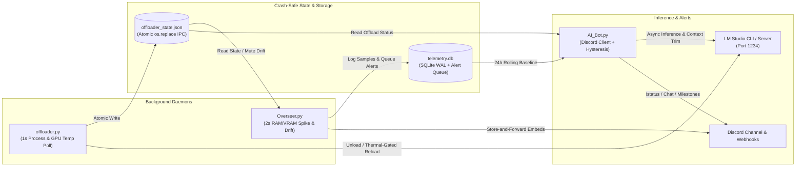

[](https://github.com/FragzDuppy-afk/local-ai-discord-companion/actions/workflows/tests.yml)


# Local AI Companion & Hardware Telemetry Suite

A cross-platform (Windows & Linux), modular, locally hosted Discord AI companion powered by **LM Studio**, paired with an automated game-aware VRAM offloader and a real-time hardware spike monitor.

## Why This Architecture?
Running a local LLM on a daily-driver gaming PC usually creates a conflict: either the model consumes GPU VRAM and System RAM while you game, or you have to manually open LM Studio and unload models every time you launch a heavy title.

This suite splits responsibilities across three lightweight Python services that communicate through a shared atomic JSON state file (`offloader_state.json`) and a local SQLite telemetry database (`telemetry_db.py`):
* **`AI_Bot.py` (Core Discord Companion):** Handles natural conversation, live DuckDuckGo web search, real-time weather reports, scheduled Cycle Start/End check-ins, single-fire gaming session break reminders, and dynamic context trimming when GPU VRAM crosses 80%. Intentionally scoped to text generation (with vision projection archived) to preserve 8 GB VRAM headroom and fast response times.
* **`offloader.py` (Game-Aware VRAM Watchdog & Session Tracker):** Polls active processes every second against your configured game library (`games_config.json`, supporting both Windows libraries and Linux Steam/Proton paths). When a non-whitelisted game launches, it executes `lms unload --all` to free GPU VRAM and System RAM, tracks continuous session time (with a crash/update grace period), and gates automatic model reloads until both the exit cooldown and GPU thermal ceiling (`RELOAD_MAX_GPU_TEMP_C`) pass.
* **`Overseer.py` (Hardware Spike Telemetry):** Monitors sustained GPU VRAM and System RAM spikes (default: ≥ 85% for 10+ seconds), logs 24-hour rolling baselines via SQLite (`telemetry.db`), sends Discord webhook alerts listing top resource consumers (muted automatically during active gaming), and triggers an emergency unload if either GPU VRAM or System RAM reaches critical levels.

### System Data & Control Flow




---

## Project Structure

```text
ai-bot/
├── AI_Bot.py                   # Core Discord bot & LM Studio client (Windows & Linux)
├── offloader.py                # Automated game detector, thermal reload gate & session timer
├── Overseer.py                 # Sustained RAM/VRAM spike & rolling baseline daemon
├── telemetry_db.py             # SQLite WAL telemetry & offline alert queue helper
├── Toggle_AI_Bot.bat           # One-click Windows start/stop background toggle
├── toggle_ai_bot.sh            # One-click Linux start/stop background toggle
├── requirements.txt            # Cross-platform Python dependencies
├── .env.example                # Environment variable template
├── games_config.example.json   # Cross-platform game library & whitelist template
├── presets/
│   └── default.json            # Default "Atlas" character preset
├── Sounds/
│   └── .gitkeep                # Optional folder for local voice-channel audio clips
└── tests/
    └── test_telemetry_and_offloader.py  # Unit tests for SQLite WAL & atomic IPC
```

---

## Prerequisites
* **Python 3.10+** (`python3-venv` required on Debian/Ubuntu-based Linux distros)
* **[LM Studio](https://lmstudio.ai)** installed with the `lms` CLI available in your system `PATH` and the local server enabled (default port `1234`).
* **Discord Bot Token** (with **Message Content Intent** enabled in the [Discord Developer Portal](https://discord.com)).
* **NVIDIA GPU with `nvidia-ml-py` (`pynvml`)** (recommended for live VRAM percentage and GPU temperature reload gating; falls back gracefully to RAM-only mode on systems without NVIDIA drivers).
* **FFmpeg** (optional—only required if you use voice-channel audio commands).

---

## Quick Setup

### 1. Register LM Studio CLI & Install Dependencies

#### Windows
Open a terminal in the project folder, register the `lms` CLI in your Windows PATH once, and install Python packages:
```cmd
lms bootstrap
pip install -r requirements.txt
```

#### Linux
Install system prerequisites (`python3-venv` and optional `ffmpeg`), register `lms`, and install dependencies inside a virtual environment (required by PEP 668 on modern distros):
```bash
# Ubuntu / Debian / Mint:
sudo apt update && sudo apt install -y python3-venv python3-pip ffmpeg

# Arch / EndeavourOS / Manjaro:
sudo pacman -S --needed python ffmpeg

# Register LM Studio CLI and verify PATH
~/.cache/lm-studio/bin/lms bootstrap
source ~/.bashrc

# Create virtual environment and install dependencies
python3 -m venv venv
source venv/bin/activate
pip install -r requirements.txt
```

### 2. Configure Environment Variables
Copy `.env.example` to `.env` and fill in your credentials and preferences:
```bash
# Windows
copy .env.example .env

# Linux
cp .env.example .env
```
* **Core & Discord:** `DISCORD_TOKEN`, `CHANNEL_ID`, `CHARACTER_PRESET` (defaults to `default` for **Atlas**), `DEFAULT_LOCATION`, `TIMEZONE_LABEL`, and `CYCLE_END_HOUR`.
* **LM Studio:** `LM_STUDIO_URL`, `LM_STUDIO_PORT`, and `LLM_MODEL` (e.g., `google/gemma-4-e2b`).
* **Offloader & Thermal Gate:** `OFFLOADER_AUTO_RELOAD`, `OFFLOADER_RELOAD_COOLDOWN`, and `RELOAD_MAX_GPU_TEMP_C` (default: `60`°C—prevents reloading model weights onto a heat-soaked GPU right after closing a game).
* **Gaming Session Reminders (Optional):** `SESSION_REMINDER_ENABLED`, `SESSION_ALERTS_ENABLED`, `SESSION_REMARK_MINS` (default: `120`), `SESSION_ESCALATE_MINS` (default: `240`), and `SESSION_GRACE_MINS` (default: `5`—preserves session timers across quick game restarts). Set reminder/alert flags to `false` to disable break notifications completely.
* **Overseer Telemetry:** `OVERSEER_WEBHOOK_URL`, `OVERSEER_VRAM_THRESHOLD`, `OVERSEER_RAM_THRESHOLD`, and `OVERSEER_DRIFT_DELTA`.

### 3. Configure Game Watchdog (Optional)
Copy `games_config.example.json` to `games_config.json` and customize your Steam/Xbox/Proton install directories, whitelisted lightweight games, and standalone heavy executables:
```bash
# Windows
copy games_config.example.json games_config.json

# Linux
cp games_config.example.json games_config.json
```

### 4. Run the Suite
* **One-Click Background Toggle (Windows & Linux):** Use `Toggle_AI_Bot.bat` on Windows or `./toggle_ai_bot.sh` on Linux to start or stop the background suite (`offloader.py`, `Overseer.py`, `AI_Bot.py`).
* **Manual / Terminal Mode:** Run each script individually in separate terminal tabs, panes, or `tmux` sessions.

---

## Discord Commands
* **`!status`**: Displays a live hardware manifest (CPU load, System RAM, GPU VRAM, 24-hour rolling baseline status, free primary drive space, and AI backend state).
* **`!transmit`**: Generates an atmospheric 2-paragraph dispatch using your active preset's prompt scenarios (falls back to cached logs if VRAM is constrained).
* **`!screenoff`**: Powers down connected displays (`WM_SYSCOMMAND` on Windows; `xset dpms force off` on Linux X11 sessions).
* **Custom Audio Commands**: Any command mapped under `"audio_commands"` in your active preset (e.g., `!chime` in `default.json`) joins your active voice channel and plays the corresponding `.mp3` from `Sounds/`.
* **Natural Chat, Weather & Web Search**: Mention words like `weather` or `forecast` for live telemetry, or ask the bot to `search` / `look up` current topics via DuckDuckGo.

---

## Creating Custom Character Presets
You can create a new AI persona without modifying Python code:
1. Duplicate `presets/default.json` (e.g., `presets/my_character.json`).
2. Customize `bot_name`, `user_title`, `system_prompt`, `transmit_prompt`, `transmit_scenarios`, `fallback_fragments`, and `audio_commands`.
3. Set `CHARACTER_PRESET=my_character` in your `.env` file and restart the bot. *(Note: On Linux, ensure preset and `Sounds/` filenames match exact uppercase/lowercase spelling.)*

---

## Troubleshooting First Boot

### Cross-Platform & Windows
* **Bot Doesn't Come Online via `Toggle_AI_Bot.bat`:** Because `Toggle_AI_Bot.bat` runs `pythonw.exe` silently in the background, startup errors (like a missing `.env` token or disabled **Message Content Intent** in the Discord Developer Portal) won't show a window. Run `python AI_Bot.py` once in a terminal to read the exact startup error.
* **Model Not Found / Empty Replies:** Ensure `LLM_MODEL` in your `.env` matches an exact model identifier downloaded in LM Studio. Run `lms ls` in your terminal to copy the exact model string.
* **Offloader Doesn't Trigger for Games on Custom Drives:** By default, `offloader.py` watches standard Windows `C:\`/`D:\` paths and `~/.local/share/Steam` / Flatpak Steam directories on Linux. If your games are installed elsewhere, copy `games_config.example.json` to `games_config.json` and add your library folder path.

### Linux-Specific
* **`error: externally-managed-environment` during `pip install`:** Modern Linux distros block global `pip` installs. Activate your virtual environment (`source venv/bin/activate`) before installing `requirements.txt`.
* **`'lms' CLI not found in PATH`:** If `lms` isn't recognized after running `lms bootstrap` (or inside background services), symlink it globally: `sudo ln -s ~/.cache/lm-studio/bin/lms /usr/local/bin/lms`.
* **`Archive Missing` or Preset Not Found:** Linux filesystems (`ext4`, `btrfs`) are strictly case-sensitive. Verify your `Sounds/` and `presets/` filenames match the exact casing in your `.env` and JSON configs.
* **`!status` Shows `0.0/0.0 GB` VRAM:** Verify proprietary NVIDIA drivers are active (`nvidia-smi` works in terminal). AMD/Intel GPUs safely fall back to RAM-only monitoring.
* **`!screenoff` Unavailable on Wayland:** Wayland compositors block external DPMS power-off commands for security; `!screenoff` works natively on X11 sessions.

