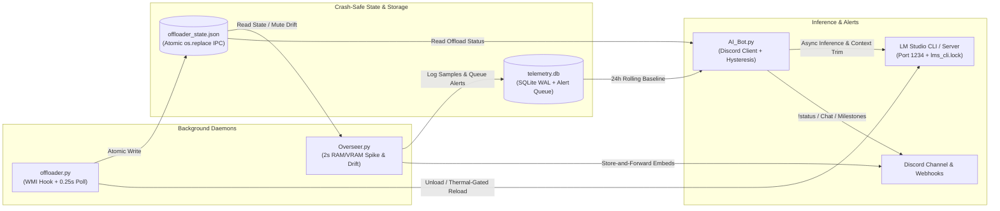

[](https://github.com/FragzDuppy-afk/local-ai-discord-companion/actions/workflows/tests.yml)


# Local AI Companion & Hardware Telemetry Suite

A fault-tolerant, cross-platform (Windows & Linux) AI orchestration engine that bridges local LLMs (**LM Studio**) with cloud failover (**Gemini API**), real-time GPU/RAM telemetry daemons, and sub-millisecond process watchdogs.

## Core Engineering Highlights (System Resilience & Operations)

Built to run unattended on consumer hardware without Out-of-Memory (OOM) crashes, CLI race conditions, or dropped alerts:

* **Fault-Tolerant Local-to-Cloud Failover:** Automatically trims conversation context at **80% VRAM** and seamlessly reroutes active Discord sessions to the Gemini OpenAI-compatible endpoint when local VRAM is offloaded or mid-unload—preserving a 10-message context window with zero dropped requests.
* **Crash-Safe IPC & Concurrency Control:** Coordinates three independent background daemons (`AI_Bot.py`, `offloader.py`, `Overseer.py`) using atomic `os.replace()` JSON state writes (`offloader_state.json`) and an `O_EXCL` cross-process file lock (`lms_cli.lock`) with stale-lock recovery to prevent simultaneous CLI collisions.
* **Anti-Flapping & Thermal-Gated Recovery:** Filters out brief hardware spikes using sustained threshold timers (`>= 85%` for `10s+`), hysteresis pause/resume bands (`90%` pause / `70%` resume), post-exit cooldowns, and NVML GPU thermal ceilings (`RELOAD_MAX_GPU_TEMP_C`) so weights never reload onto a heat-soaked GPU.
* **Event-Driven Process Detection:** Uses a Windows WMI `Win32_Process` creation hook (with a `0.25s` cross-platform `psutil` fallback) and anti-cheat process-name matching to unload local weights via `lms unload --all` and verify VRAM release via `pynvml` before heavy workloads allocate memory.
* **Store-and-Forward Telemetry & Drift Detection:** Logs 24-hour rolling RAM/VRAM baselines in **SQLite (WAL mode)** (`telemetry.db`), detects idle baseline drift (`+25%` delta), and buffers Discord webhook alerts locally during network outages for automatic replay upon reconnection.

---

## System Architecture & Control Flow



---
## Live Resilience Proof: Telemetry, Offloading & Anomaly Detection

All four outputs below were captured live on a consumer workstation (**NVIDIA GeForce RTX 4060 8 GB / 32 GB RAM**)—demonstrating how the suite manages local LLM memory, preemptively frees VRAM for games, and isolates third-party memory leaks before saturation occurs.

### 1. Normal Baseline (`!status` — Local Inference Active)
```text
=== STATIC HARDWARE & EQUIPMENT MANIFEST ===
CPU LOAD     :  11.9%  | NOMINAL
SYSTEM RAM   : 14.6/31.8 GB (45.8%) | NOMINAL (24h Avg: 42.5%)
GPU VRAM     : 4.52/8.0 GB (56.5%) | NOMINAL (24h Avg: 35.6%)
PRIMARY SSD  : 586.9 GB Free | NOMINAL
24H BASELINE : 4,697 Samples Logged | SQLite WAL Active
AI BACKEND   : google/gemma-4-e2b (Port 1234/v1) | ONLINE | Offloader: LIVE
============================================
```

### 2. Preemptive Game Offload (`!status` — Offloaded + Cloud Failover)
```text
=== STATIC HARDWARE & EQUIPMENT MANIFEST ===
CPU LOAD     :  33.5%  | NOMINAL
SYSTEM RAM   : 15.9/31.8 GB (49.8%) | NOMINAL (24h Avg: 42.6%)
GPU VRAM     : 3.67/8.0 GB (45.9%) | NOMINAL (24h Avg: 35.6%)
PRIMARY SSD  : 587.0 GB Free | NOMINAL
24H BASELINE : 4,783 Samples Logged | SQLite WAL Active
AI BACKEND   : google/gemma-4-e2b (Port 1234/v1) | PAUSED | Offloader: LIVE
============================================
```
* **Result:** `offloader.py` intercepted the game launch via WMI/process hooks and unloaded `google/gemma-4-e2b` before memory saturation could occur—dropping GPU VRAM from **56.5% (4.52 GB)** down to **45.9% (3.67 GB)** *during* an active game while `AI_Bot.py` (`STATIC`) shifted cleanly to `PAUSED` (Gemini cloud fallback).

### 3. Proactive Baseline Calibration & Leak Attribution (`Overseer.py` Webhook Relay)
```text
[OVERSEER UNIT 01 // SUB-PROCESS ONLINE]
Automated hardware telemetry & surge relay (pynvml / psutil / sqlite3).
Logging rolling baselines and watching VRAM/RAM capacity.
• Primary GPU          : NVIDIA GeForce RTX 4060
• Initial VRAM         : 4577 / 8188 MB (55.9%) | System RAM: 45.9%
• 24h Rolling Baseline : RAM 42.5% | VRAM 35.2% (4,683 samples)
• Alert Thresholds     : VRAM ≥ 85% | RAM ≥ 85%

📈 [EARLY DRIFT WARNING // GPU VRAM]
VRAM jumped +27.0% above your 24h baseline while LLM active.
• Live vs. 24h Baseline : 62.9% (Avg: 35.9%)
• Top VRAM Consumers    :
  • SignalRgb.exe: 4076 MB
  • llama-server.exe: 3151 MB
  • dwm.exe: 2632 MB
```
* **Result:** Rather than waiting for a hard `85%` critical spike, `Overseer.py` detected a **+27.0% drift** against its 24-hour SQLite rolling baseline and immediately attributed the leak to a runaway background utility (`SignalRgb.exe` consuming 4.07 GB) alongside the local inference server (`llama-server.exe`).

---

## Project Structure

```text
ai-bot/
├── AI_Bot.py                   # Core Discord bot, hysteresis & cloud failover client
├── offloader.py                # WMI/psutil game detector, thermal reload gate & session timer
├── Overseer.py                 # Sustained RAM/VRAM spike, drift & SQLite alert daemon
├── telemetry_db.py             # SQLite WAL telemetry & store-and-forward alert queue
├── Toggle_AI_Bot.bat           # One-click Windows start/stop background toggle (.venv aware)
├── toggle_ai_bot.sh            # One-click Linux start/stop background toggle
├── requirements.txt            # Cross-platform Python dependencies
├── .env.example                # Environment variable & threshold template
├── games_config.example.json   # Cross-platform game library, anti-cheat & whitelist template
├── presets/
│   ├── default.json            # Default "Atlas" character preset
│   └── vesper.json             # Alternate hardware-reactive dual-voice "Vesper" preset
├── Sounds/
│   └── .gitkeep                # Optional folder for local voice-channel audio clips
└── tests/
    └── test_telemetry_and_offloader.py  # Unit tests for SQLite WAL & atomic IPC
```

---

## Getting Started (User Setup & Configuration)

<details>
<summary><strong>1. Prerequisites</strong> (Click to expand)</summary>

* **Python 3.10+** (`python3-venv` required on Debian/Ubuntu-based Linux distros)
* **[LM Studio](https://lmstudio.ai)** installed with the `lms` CLI available in your system `PATH` and the local server enabled (default port `1234`).
* **Discord Bot Token** (with **Message Content Intent** enabled in the [Discord Developer Portal](https://discord.com)).
* **NVIDIA GPU with `nvidia-ml-py` (`pynvml`)** (recommended for live VRAM percentage, VRAM release verification, and GPU temperature reload gating; falls back gracefully to RAM-only mode on systems without NVIDIA drivers).
* **`wmi` & `pywin32` (Optional, Windows only):** Enables sub-millisecond process-creation triggers in `offloader.py`. If omitted, `offloader.py` automatically falls back to `0.25s` `psutil` polling.
* **FFmpeg** (optional—only required if you use voice-channel audio commands).
</details>

<details>
<summary><strong>2. Installation (Windows & Linux)</strong> (Click to expand)</summary>

#### Windows
Open a terminal in the project folder, register the `lms` CLI in your Windows PATH once, and install Python packages:
```cmd
lms bootstrap
pip install -r requirements.txt
pip install wmi pywin32
```

#### Linux
Install system prerequisites, register `lms`, and install dependencies inside a virtual environment (required by PEP 668 on modern distros):
```bash
# Ubuntu / Debian / Mint:
sudo apt update && sudo apt install -y python3-venv python3-pip ffmpeg

# Arch / EndeavourOS / Manjaro:
sudo pacman -S --needed python ffmpeg

# Register LM Studio CLI and verify PATH
~/.cache/lm-studio/bin/lms bootstrap
source ~/.bashrc

# Create virtual environment and install dependencies
python3 -m venv venv
source venv/bin/activate
pip install -r requirements.txt
```
</details>

<details>
<summary><strong>3. Environment & Watchdog Configuration</strong> (Click to expand)</summary>

1. **Configure `.env`:** Copy `.env.example` to `.env` and set your credentials and thresholds:
   * **Core & Discord:** `DISCORD_TOKEN`, `CHANNEL_ID`, `CHARACTER_PRESET` (defaults to `default` for **Atlas**), `DEFAULT_LOCATION`, `TIMEZONE_LABEL`, `CYCLE_END_HOUR`.
   * **LM Studio & Cloud Failover:** `LM_STUDIO_URL`, `LM_STUDIO_PORT`, `LLM_MODEL` (e.g., `google/gemma-4-e2b`), plus optional `GEMINI_API_KEY` and `GEMINI_FALLBACK_MODEL` for cloud offload routing.
   * **Offloader & Thermal Gate:** `OFFLOADER_POLL_INTERVAL` (`0.25`s), `OFFLOADER_AUTO_RELOAD`, `OFFLOADER_RELOAD_COOLDOWN`, and `RELOAD_MAX_GPU_TEMP_C` (`60`°C).
   * **Overseer Telemetry:** `OVERSEER_WEBHOOK_URL`, `OVERSEER_VRAM_THRESHOLD`, `OVERSEER_RAM_THRESHOLD`, and `OVERSEER_DRIFT_DELTA`.
2. **Configure `games_config.json`:** Copy `games_config.example.json` to `games_config.json` to customize `watched_game_dirs` (Steam/Xbox/Proton libraries) and `watched_process_names` (anti-cheat engines like BattlEye/EAC and standalone launchers).
</details>

<details>
<summary><strong>4. Running & Testing the Suite</strong> (Click to expand)</summary>

* **One-Click Background Toggle:** Run `Toggle_AI_Bot.bat` on Windows (`.venv` aware) or `./toggle_ai_bot.sh` on Linux to start or stop all three daemons together.
* **Run Automated Unit Tests:** Verify atomic JSON IPC, PDH VRAM parsing, SQLite WAL rolling baselines, and store-and-forward alert queueing using Python's built-in `unittest` runner:
  ```bash
  python -m unittest discover -s tests -v
  ```
  ```text
  [Offloader] Loaded game config: games_config.json
  test_atomic_state_roundtrip (test_telemetry_and_offloader.TestOffloaderRules.test_atomic_state_roundtrip) ... ok
  test_pdh_vram_fallback_parses_and_sums_processes (test_telemetry_and_offloader.TestOverseerTelemetry.test_pdh_vram_fallback_parses_and_sums_processes) ... ok
  test_rolling_baseline_ignores_offloaded_samples (test_telemetry_and_offloader.TestTelemetryDB.test_rolling_baseline_ignores_offloaded_samples) ... ok
  test_store_and_forward_alert_queue (test_telemetry_and_offloader.TestTelemetryDB.test_store_and_forward_alert_queue) ... ok

  ----------------------------------------------------------------------
  Ran 4 tests in 0.048s

  OK
  ```
</details>

---

## Discord Commands & Custom Personas
* **`!status`**: Displays live CPU, RAM, GPU VRAM, 24-hour rolling baseline stats, disk headroom, backend state, and `Offloader: LIVE/OFFLINE` status.
* **`!search <query>` / Natural Search**: Runs sanitized DuckDuckGo lookups with a two-step regional retailer fallback and anti-hallucination guardrails.
* **`!transmit`**: Generates a 2-paragraph telemetry broadcast (automatically falls back to cloud or cached logs when VRAM is constrained).
* **`!clear` / `!help` / `!screenoff`**: Resets short-term context, lists active commands, or powers down connected monitors.
* **Custom Presets (`presets/`):** Switch between `default` (Atlas) and `vesper` (hardware-reactive dual-voice persona) via `CHARACTER_PRESET` in `.env`, or add your own JSON preset.

---

## Troubleshooting First Boot

<details>
<summary><strong>Click to expand Cross-Platform, Windows & Linux Troubleshooting</strong></summary>

* **Bot Doesn't Come Online via `Toggle_AI_Bot.bat`:** Because `Toggle_AI_Bot.bat` runs `pythonw.exe` silently in the background, startup errors (like a missing `.env` token or disabled **Message Content Intent**) won't show a window. Run `python AI_Bot.py` once in a terminal to read the exact error.
* **Model Not Found / Empty Replies:** Ensure `LLM_MODEL` in `.env` matches an exact model identifier from `lms ls`.
* **`error: externally-managed-environment` on Linux:** Activate your virtual environment (`source venv/bin/activate`) before running `pip install`.
* **`'lms' CLI not found in PATH` on Linux:** Symlink it globally: `sudo ln -s ~/.cache/lm-studio/bin/lms /usr/local/bin/lms`.
* **Case-Sensitive Paths on Linux:** Verify `Sounds/` and `presets/` filenames match the exact casing in your `.env` and JSON configs.
</details>
